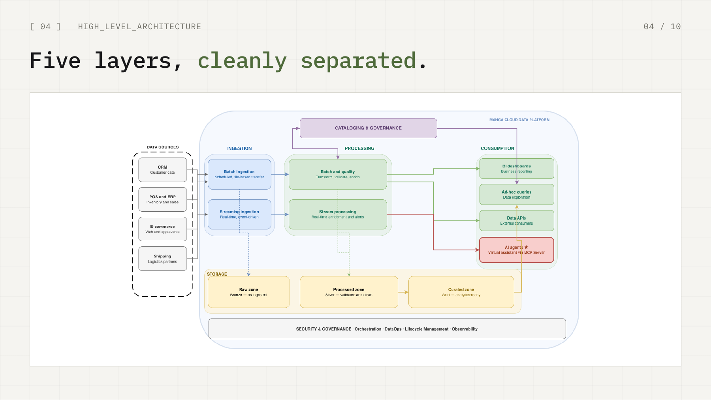

# Manga: Retail Cloud Data Modernization

A team architecture proposal for moving a fictional fashion retailer from daily batch pipelines and manual Excel reporting to an AWS lakehouse with batch and streaming ingestion, governed analytics, and AI access through approved tools.

**Academic case study · Cloud architecture and delivery planning · June 2026**

**[Read the proposal (PDF, 18 pages)](docs/CloudIt_Manga_RFP_Report.pdf)** · **[View the pitch deck (PDF, 10 slides)](docs/Manga%20Pitch%20Deck.pdf)**

## Project overview

Prepared for IE Business School's *Data Analytics in the Cloud* course, this project responds to an RFP for modernizing Manga's data platform. Manga is the fictional retailer in the course scenario; CloudIt is the team's proposal identity. This is an academic proposal, not a production engagement with Mango.

The design brings CRM, point-of-sale/ERP, e-commerce, and shipping data into a shared platform. It combines a Bronze/Silver/Gold lakehouse with separate batch and streaming paths, BI and API serving, and governance across the data lifecycle.

[](assets/high-level-architecture.png)

*Original team diagram, reproduced from slide 4 of the pitch deck. Click to enlarge.*

## My contribution

I developed **Section 4: Project Implementation**. The report's Appendix B credits me with:

- Mapping the eight RFP requirements (R1–R8) to the proposed implementation.
- Designing the DataOps and CI/CD approach across development, pre-production, and production.
- Planning the phased migration roadmap.
- Defining the proposed AI-agent and Model Context Protocol (MCP) approach.

These contributions describe architecture and implementation planning. The folder contains no deployed infrastructure or standalone application source.

## Proposed architecture and tools

| Area | Services and tools discussed in the report |
| --- | --- |
| Ingestion | Amazon AppFlow, AWS DMS with change data capture, AWS DataSync, Kinesis Data Streams and Firehose |
| Lakehouse and metadata | Amazon S3 Bronze/Silver/Gold zones, Apache Iceberg, AWS Glue Data Catalog |
| Processing and quality | AWS Glue ETL and Data Quality, Amazon Managed Service for Apache Flink |
| Analytics and serving | Amazon Redshift Serverless, Athena, QuickSight, DynamoDB, API Gateway and Lambda |
| AI access | Amazon Bedrock Agents and a proposed MCP server exposing approved tools |
| Delivery and orchestration | AWS CDK, CodePipeline, CodeBuild, Step Functions and EventBridge |
| Security and operations | IAM, KMS, Lake Formation, Macie, CloudTrail and CloudWatch |

These are the **proposed stack**, not verified implementations. The report acknowledges Claude, ChatGPT, and diagrams.net/draw.io as authoring aids in Appendix A.

**[View the AWS service diagram](assets/aws-service-architecture.png)**, reproduced from slide 5 of the pitch deck.

## Outputs and proposed results

The deliverables are an 18-page proposal and a 10-slide pitch deck. The proposal includes an eight-requirement mapping, a nine-month migration plan, a risk register, acceptance criteria, and five use-case designs: a shopping assistant, demand forecasting, dynamic pricing, supply-chain anomaly detection, and customer sentiment analysis.

| Proposal item | Interpretation |
| --- | --- |
| Nine-month roadmap | Three planned phases: foundation, BI/governance, and real-time/AI |
| €282,000–€561,000 Year 1 estimate | Indicative total including €120,000–€200,000 for migration and professional services; not a pure recurring AWS run cost |
| 40–60% infrastructure savings | A projection in the proposal; no measured baseline or realized savings are supplied |
| Sub-minute streaming and low-latency lookups | Design targets and illustrative examples; no benchmark logs are supplied |

No deployment, measured business impact, model evaluation, or performance test results are included. The [project notes](docs/PROJECT_NOTES.md) explain known inconsistencies and the limits of the evidence.

## Explore the project

1. Open the pitch deck for a quick overview.
2. Read the report for the architecture, implementation plan, costs, risks, and use cases.
3. See Appendix B for individual contributions and Appendix C for the original references.

Any PDF viewer is sufficient. There are no installation steps, application commands, dependency manifests, or deployment instructions to run. Appendix E contains an illustrative Python AWS CDK storage construct, but no CDK app, configuration, dependencies, or tests accompany it; it is not a complete deployable project.

## Repository contents

```text
README.md
assets/
  high-level-architecture.png
  aws-service-architecture.png
docs/
  CloudIt_Manga_RFP_Report.pdf
  Manga Pitch Deck.pdf
  PROJECT_NOTES.md
```

Course handouts, course-provided sample datasets, a duplicate ZIP, and a detailed deck marked confidential are excluded from the publication set. The report and pitch deck can be reviewed without them.

## Team and attribution

Contributions below are transcribed from the report's Appendix B. Nicolas is listed there by first name only.

| Contributor | Credited responsibility |
| --- | --- |
| Marian Garabana | Sections 1–2: executive summary, high-level architecture, business case, requirements coverage, document coordination |
| Nuria Etemadi | Section 3: low-level architecture and seven-layer service breakdown |
| Isha Shah and Nicolas | Section 4: requirements matrix, DataOps/CI/CD, migration roadmap, AI agents/MCP |
| Dalton Kern | Section 5: the five use cases |
| Nuria Diaz | Section 6 and appendices: future improvements, appendix preparation, reference consolidation, final assembly |

The original PDFs retain the team's credits, references, and AI acknowledgement. No reuse license was supplied with the project, and no license has been added. Publication does not establish permission to reuse course materials or other contributors' work.
